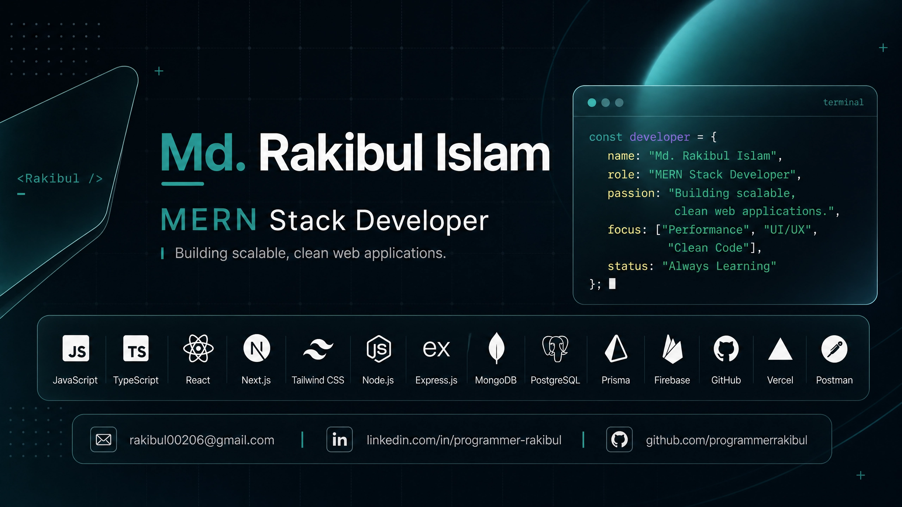

  

  <h1>Hey, I'm Rakibul Islam 👋</h1>

  

    

  

    
    
    
  

 

---

### 🧠 About Me

Passionate **Full-Stack Developer** from Bangladesh focused on building clean, performant, and scalable web applications.

I work primarily with the **MERN** stack and modern **Next.js** applications, with strong emphasis on TypeScript, clean architecture, and developer experience.

---

### 🎯 Currently

| Focus | Details |
|:------|:--------|
| 🛠️ Working On | **Proforma Invoice Generator** |
| 📚 Learning | Docker |
| 🚀 Next Goal | Redis |
| 🧰 Current Stack | Next.js • TypeScript • MongoDB • Mongoose • Better Auth • Redux Toolkit |

---

### 🛠️ Tech Stack

#### Frontend

#### State Management

#### Backend & Auth

#### Database

#### Tools & Deployment

---

### 📊 GitHub Analytics

  
  
   
  

---

### 🐍 Contribution Activity

  <picture>
    <source media="(prefers-color-scheme: dark)" srcset="https://raw.githubusercontent.com/programmerrakibul/programmerrakibul/output/github-contribution-grid-snake-dark.svg" />
    
  </picture>

---

### 🤝 Let's Connect

  
  
  
  

 

  <i>"The expert in anything was once a beginner."</i>

